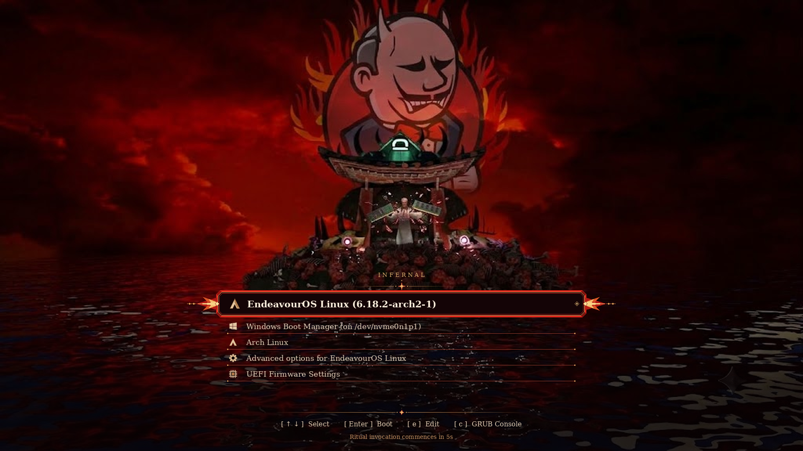
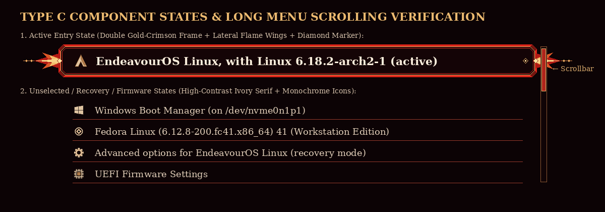

# INFERNAL — Cinematic Universal GRUB Theme (`Type C: Lower-Water Ritual Console`)

> *This GRUB theme is for DevOps who suffer with Jenkins — where every reboot is a RAM sacrifice to the Jenkins Devil.*



**INFERNAL** is a production-grade GNU GRUB 2.x bootloader theme and universal multi-distro installation suite built around the **Jenkins Devil RAM-Sacrifice Summoning Scene** (`image-clean.png` / `devil-jenkins.png` **Type C** format).

---

## 1. Visual Design & Artwork Preservation (`Type C`)

- **Sacred Scene Integrity**: The Jenkins Devil, teal-lit shrine roof, RAM-snapping summoner, and central skull island (`y = 0%..62%`) are **100% unmodified and unobstructed**.
- **Type C Lower-Water Ornate Banner**: Placed entirely in the dark reflective ocean (`y = 65%..89%`), the active entry features a bevelled crimson-and-gold double frame, **76px lateral flame-and-filigree wing flourishes**, and a **bronze diamond active indicator (`◇`)** so selection is unmistakable even without relying solely on color.
- **Frameless Secondary Entries**: Unselected OS entries sit cleanly over the darkened water reflections with warm ivory serif typography (`DejaVu Serif Regular 16` / `DejaVu Serif Bold 18`) and crisp `32×32` monochrome icons.
- **Resolution Variants Included**: `1920x1080` (`16:9` default), `2560x1440` (`16:9` QHD), `1920x1200` (`16:10`), `1024x768` (`4:3`), `original` (`1024x576` untouched source), and a `3.9 KiB` `fallback.png`.




---

## 2. Quick Start & Safe Installation

The installer ([`install.sh`](install.sh)) defaults to read-only help when invoked without flags and never modifies the host without explicit authorization.

```bash
# 1. Inspect compatibility, bootloader state, and discovered OS entries (read-only)
./install.sh --check

# 2. Preview exact planned file & config changes (read-only unified diff)
./install.sh --dry-run

# 3. Install the INFERNAL Type C theme (creates SHA-256 backups & validates grub.cfg)
sudo ./install.sh --install

# Optional: Install with a specific resolution or untouched source artwork
sudo ./install.sh --install --resolution 2560x1440
sudo ./install.sh --install --resolution original
```

---

## 3. Uninstallation & Emergency Recovery

```bash
# Remove INFERNAL and restore your exact pre-INFERNAL /etc/default/grub & theme
sudo ./uninstall.sh
# or equivalently:
sudo ./install.sh --uninstall
```

- **Automatic Mid-Install Rollback**: If any step during `--install` fails or is interrupted (`Ctrl+C` or `grub-script-check` failure), an `EXIT`/`INT`/`TERM` trap automatically cleans up partial files and restores the SHA-256 verified backup from `/var/backups/infernal-grub-theme/`.
- **GRUB Console Fallback**: At the GRUB menu, press `c` and run `terminal_output console; normal` at any time to switch to plain-text mode for the current boot.

---

## 4. Project Structure

```text
.
├── README.md
├── LICENSE
├── image-clean.png                  # Untouched original source artwork (1024x576)
├── devil-jenkins.png                # Reference layout sheet (A / B / C)
├── install.sh                       # Production installer (--check, --dry-run, --install, --uninstall)
├── uninstall.sh                     # Safe uninstaller wrapper
├── theme/
│   ├── theme.txt                    # GRUB 2.x gfxmenu configuration (Type C layout)
│   ├── backgrounds/                 # 1080p, 1440p, 16:10, 4:3, original, and fallback PNGs
│   ├── fonts/                       # Pre-compiled GRUB .pf2 fonts (DejaVu Serif & Mono)
│   ├── icons/                       # 32x32 monochrome OS & function icons
│   └── assets/
│       ├── borders/                 # 9-slice menu container pixmaps
│       ├── selection/               # 9-slice Type C ornate active banner + lateral flame wings
│       ├── item/                    # 9-slice unselected entry separators
│       ├── scrollbar/               # 9-slice scrollbar frame & thumb for large boot menus
│       ├── progress/                # 9-slice ritual timeout progress bar
│       └── ornaments/               # Compass star header sigil & footer divider
├── scripts/
│   ├── generate-assets.py           # Deterministic generator for backgrounds, 9-slices, icons, fonts, previews
│   ├── detect-system.sh             # Distro, package manager (pacman/apt/dnf/zypper), and tool detection
│   ├── detect-bootloaders.sh        # UEFI/BIOS, Secure Boot, systemd-boot/rEFInd check, and OS discovery
│   ├── validate-theme.sh            # Validates theme.txt, PNGs, PF2 headers, and grub-script-check
│   └── backup-restore.sh            # SHA-256 checksummed backups and atomic rollback
├── tests/
│   ├── test-helpers.sh              # Disposable sandbox & mock binary generator
│   ├── test-detection.sh            # 24 unit/integration assertions across distros, UEFI/BIOS, bootloaders
│   ├── test-installer.sh            # 22 assertions for install, uninstall, rollback, read-only, long menus
│   └── test-idempotency.sh          # 7 assertions verifying 3-run idempotency & baseline restoration
└── docs/
    ├── DESIGN.md                    # Artwork coordinate analysis, Type C layout & palette spec
    ├── COMPATIBILITY.md             # Distro matrix, OS detection policy, and test classification
    ├── INSTALLATION.md              # Step-by-step preview, installation, and resolution guide
    ├── TROUBLESHOOTING.md           # Emergency recovery & manual backup restoration
    └── previews/                    # Rendered composition & integrity verification images
```

---

## 5. Running the Automated Test Suite

All tests execute inside disposable temporary sandboxes (`mktemp -d`) and never touch the host's `/boot` or `/etc`:

```bash
./scripts/validate-theme.sh
./tests/test-detection.sh
./tests/test-installer.sh
./tests/test-idempotency.sh
```

---

## 6. Documentation Links

- [Design & Art Direction (`docs/DESIGN.md`)](docs/DESIGN.md)
- [Compatibility Matrix & Detection Policy (`docs/COMPATIBILITY.md`)](docs/COMPATIBILITY.md)
- [Installation & Preview Guide (`docs/INSTALLATION.md`)](docs/INSTALLATION.md)
- [Troubleshooting & Recovery (`docs/TROUBLESHOOTING.md`)](docs/TROUBLESHOOTING.md)
